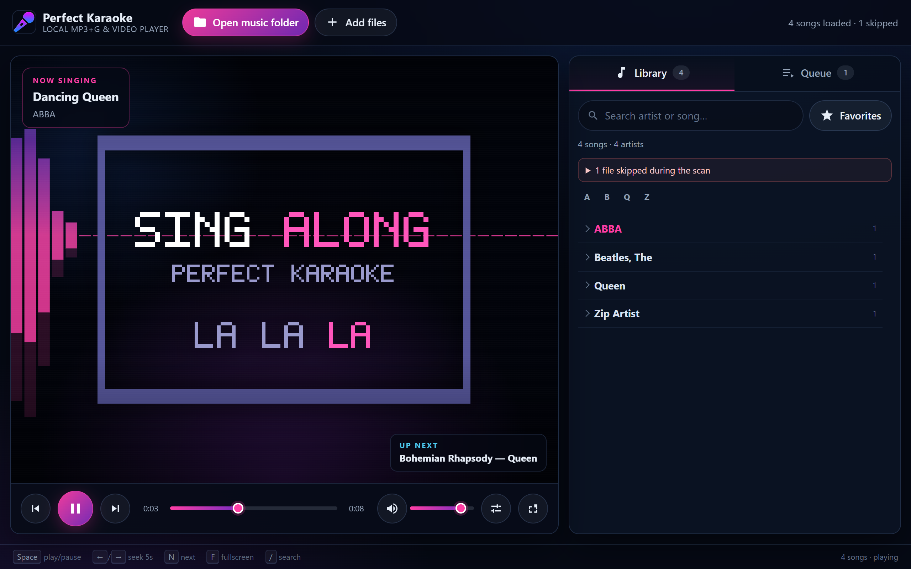

# Perfect Karaoke

A local karaoke player for MP3+G (CD+G), audio with synchronized LRC/ELRC lyrics, zipped songs, and
MP4 karaoke videos. Open a folder of songs in your browser, build a queue, and sing.

Everything runs in the browser: no backend, no accounts, no uploads, no build step. Your music never
leaves your computer.



## Quick start

```bash
npm start
```

Open <http://localhost:3000>, choose **Open music folder**, and pick the folder that holds your
songs. Node.js 20+ is required, but no `npm install` is needed to run the player.

```bash
node serve.js --port 8080        # another port
node serve.js --host 0.0.0.0     # reachable from your LAN (no authentication)
```

The server listens on `127.0.0.1` only by default and serves only the app's own files — never your
music, tests, or repository metadata. Opening `index.html` from disk does not work; the app must be
served over HTTP.

## What you can play

| Library | Files |
| --- | --- |
| MP3+G | Audio (`.mp3`, `.m4a`, `.wav`, `.ogg`, `.flac`) plus a same-name `.cdg` |
| LRC lyrics | Audio plus a same-name `.lrc`, with optional `.elrc` word timing |
| Zipped songs | `.zip` archives containing those pairs, including multi-song albums |
| Karaoke video | `.mp4` files named `Artist - Title.mp4` |

Audio and companions must share a base name in the same folder; CD+G wins when both CD+G and LRC
exist. Files that cannot be used are grouped in a skipped-files notice with a suggested fix instead
of being silently dropped. The full rules are in the [user guide](docs/USER_GUIDE.md).

## Features

- Library grouped by artist, with normalized names, alphabet jump, favourites, search, and
  media-type filters
- Media badges on every song and queue row, duplicate counts, a **Next** marker, and queue duration
  estimates
- Queue reordering (drag or buttons), move to front, play now, clear, and played history
- CD+G and LRC/ELRC lyrics with adjustable size, dimming, and click-to-seek
- Nine background visual styles that react to the music, remembered between visits
- Optional ReplayGain leveling
- MP4 audio-track selector where the browser exposes multiple tracks
- Keyboard shortcuts, fullscreen, and remembered volume and display settings
- Library restoration that remembers your folder where the browser allows it

## Documentation

| Document | Purpose |
| --- | --- |
| [Documentation index](docs/README.md) | Choose a guide by audience and task |
| [User guide](docs/USER_GUIDE.md) | Installing, organizing a library, queueing, playback, mobile use |
| [Administrator guide](docs/ADMIN_GUIDE.md) | Hosting, ports and binding, LAN exposure, security, backup, updates |
| [Developer guide](docs/DEVELOPER_GUIDE.md) | Architecture, module responsibilities, tests, debugging |
| [Troubleshooting](docs/TROUBLESHOOTING.md) | Symptom-based fixes |
| [Contributing](docs/CONTRIBUTING.md) | OpenSpec workflow, verification, changelog, docs rules |
| [Changelog](docs/CHANGELOG.md) | Release history |
| [Archive](docs/archive/README.md) | Historical QA, UX, and upstream-issue reports |

Specifications of observable behavior live in [`openspec/specs/`](openspec/specs/) and are the
authoritative contract for what the app does.

## Development

```bash
npm install    # development tools only: ESLint and the OpenSpec CLI
npm test       # node:test suite
npm run lint   # ESLint
```

The app is plain ES modules and CSS with no transpile or bundle step. See the
[developer guide](docs/DEVELOPER_GUIDE.md) for the architecture and the
[contribution workflow](docs/CONTRIBUTING.md) for changing behavior.

## Browser requirements

Chrome or Edge is recommended: it supports the File System Access API, so the player can remember
your music folder and reopen it without browsing again. Firefox, Safari, and embedded browsers can
still load songs with **Add files**, drag-and-drop, or the directory input, but ask for the folder
again on later visits. The native folder picker also requires a secure context (`http://localhost`
or `https://`).

## License

ISC. The CD+G decoder is adapted from [cdgraphics](https://github.com/bhj/cdgraphics) by Ben Hilburn
(ISC).
