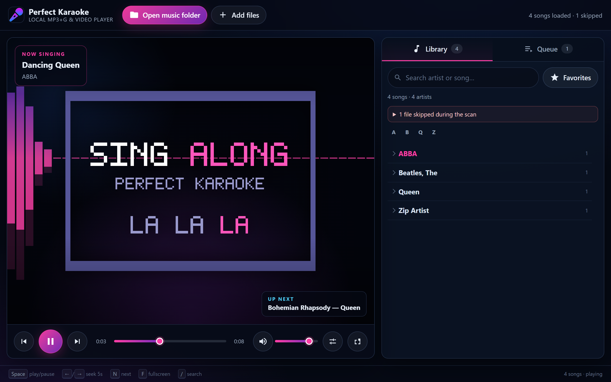

# Perfect Karaoke

A local karaoke player with support for MP3+G (CD+G), synchronized LRC/ELRC lyrics, and MP4
files. 

Open a folder of songs in your browser, build a queue, and sing.

Everything runs in the browser: there is no application backend, no accounts, no uploads, and no build step.



## Features

- MP3+G tracks (`.mp3`, `.m4a`, `.wav`, `.ogg`, `.flac` with a matching `.cdg`)
- Audio with synchronized `.lrc` lyrics and optional `.elrc` word timing
- Zipped MP3+G or LRC songs, including archives with several songs or extra files
- MP4 karaoke videos, with an audio-track selector when the browser exposes multiple MP4 tracks (currently Safari; Chromium-based browsers and Firefox play the default track)
- CD+G and LRC lyrics rendering with adjustable size and background dimming
- Current-line highlighting, ELRC word timing, automatic scrolling and click-to-seek for LRC lyrics
- Selectable audio-reactive background visuals behind the lyrics, remembered between visits (Classic, Hot Pink, Spectrum, Waveform, Aurora, Pulse, Starfield, Minimal, or Off)
- Library grouped by artist with alphabet jump, favourites and search
- Queue with drag-and-drop reordering, history and "play now"
- Optional ReplayGain volume leveling
- Keyboard shortcuts, fullscreen, and remembered volume/display settings
- Your library never leaves the computer - files are read locally by the browser

## Requirements

- [Node.js](https://nodejs.org/) 20 or newer, used only to serve the static files
- A modern browser. Chrome or Edge are recommended because they support the
  File System Access API, which lets the player remember your music folder between
  visits. Other browsers can still load songs with **Add files** or drag-and-drop.

## Running

```bash
npm start
```

Then open <http://localhost:3000>. No `npm install` is needed: the app has no
runtime dependencies, and `serve.js` uses only Node's standard library.

To use another port:

```bash
node serve.js --port 8080
# or
PORT=8080 npm start
```

The server listens on `127.0.0.1` only and serves just the player's own files
(`index.html`, `css/`, `js/` and `assets/`), so the rest of the repository is not
reachable. To open the player from another device on the same network, opt in
explicitly:

```bash
node serve.js --host 0.0.0.0
# or
HOST=0.0.0.0 npm start
```

There is no authentication, so only do that on a network you trust.

Opening `index.html` straight from disk does not work, because browsers refuse to
load ES modules over `file://`.

## Song files

Name audio and lyric files the same way in the same folder. Audio can use a
CD+G file, an LRC file, or both:

```text
Queen - Bohemian Rhapsody.mp3
Queen - Bohemian Rhapsody.cdg

Olivia Rodrigo - Drivers License.mp3
Olivia Rodrigo - Drivers License.lrc
Olivia Rodrigo - Drivers License.elrc   # optional word timing
```

When both `.cdg` and `.lrc` are present, the CD+G version is used so its visual
format is preserved. An `.elrc` file can be used on its own when its line headers
provide the lyric text. Standalone `.lrc` and `.elrc` files are not playable
tracks.

Zipped tracks work too, as long as the audio and its companion files share a
name:

```text
Queen - BoRhap.zip
  Queen - BoRhap.mp3
  Queen - BoRhap.cdg

Olivia Rodrigo - Drivers License.zip
  Olivia Rodrigo - Drivers License.mp3
  Olivia Rodrigo - Drivers License.lrc
  Olivia Rodrigo - Drivers License.elrc
```

The filename parser understands the naming conventions karaoke libraries tend to
use: `The`-article handling (`Beatles, The`), track numbers (`AZ1234-01 - ...`),
`ft.`/`feat.` variants, `[Karaoke]`-style suffixes, and `in the style of ...` titles.

Files that cannot be used are not silently dropped: anything without a matching
`.cdg`, `.lrc`, or `.elrc`, or without an `Artist - Title` separator in the name,
is counted in the "files skipped during the scan" notice above the library.
Unreadable files and corrupt archives are reported there too, and the rest of
the scan continues.

MP4 files with multiple audio tracks (for example vocal and instrumental) show
an audio-track selector in browsers that expose
`HTMLMediaElement.audioTracks`. Safari supports this API; Chromium-based
browsers and Firefox currently ship it disabled, so they play the file's
default track.

## Keyboard shortcuts

| Key | Action |
| --- | --- |
| `Space` | Play / pause |
| `←` / `→` | Seek 5 seconds |
| `N` | Next song |
| `P` | Previous song |
| `M` | Mute |
| `F` | Fullscreen |
| `/` | Focus search |

## Development

```bash
npm install    # dev tools only (ESLint)
npm test       # node:test suite
npm run lint   # ESLint
```

The app is plain ES modules and CSS with no build or transpile step:

| Path | Contents |
| --- | --- |
| `index.html` | Markup and icon sprite |
| `css/app.css` | Layout, theme and responsive rules |
| `js/app.js` | UI state, library browsing, queue, persistence |
| `js/player.js` | Audio/video playback, CD+G sync, LRC/ELRC loading, visualizer dispatch |
| `js/visualizer.js` | Background visual styles, audio sampling and selection persistence |
| `js/cdg.js` | CD+G decoder and renderer |
| `js/lrc.js` | LRC/ELRC parsing and word-timing alignment |
| `js/library.js` | Filename parsing, file pairing, resilient scanning, search |
| `js/zip.js` | Minimal ZIP reader (stored + deflate) |
| `js/audio-tags.js` | ReplayGain tag parsing |
| `js/audio-tracks.js` | Multi-track MP4 audio switching (browser permitting) |
| `serve.js` | Static file server for development and local use |
| `test/` | Unit tests for parsing, pairing, ZIP reading, scanning, CD+G, LRC/ELRC, ReplayGain, audio tracks and the server, plus short real MP3+G excerpts in `test/fixtures/media/` |

See [docs/UPSTREAM_ISSUE_ROADMAP.md](docs/UPSTREAM_ISSUE_ROADMAP.md) for the
complete audit of upstream KaraokeEternal issues and the remaining work.

## Licence

ISC. The CD+G decoder is adapted from [cdgraphics](https://github.com/bhj/cdgraphics)
by Ben Hilburn (ISC).
