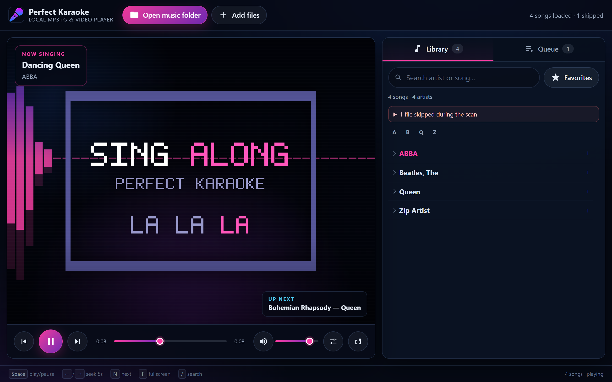

# PerfectKaraokeEternal user guide

PerfectKaraokeEternal is a karaoke player that runs entirely in your web browser. It reads a
folder of songs from your own computer, builds a library, and plays MP3+G, audio with synchronized
lyrics, zipped songs, and MP4 karaoke videos. There are no accounts, no uploads, and no cloud
storage: the browser reads the files directly and nothing leaves the machine.



## 1. Before you start

You need:

- A computer with a modern browser. **Chrome or Edge is recommended**, because those browsers let
  the player remember your music folder between visits.
- The player opened from `http://localhost` (or an `https://` address). Opening `index.html`
  directly from disk does not work, because browsers refuse to load the app's modules that way.
- A karaoke library in one of the supported layouts below.

### Supported files

| What you have | Files needed | Result |
| --- | --- | --- |
| MP3+G (CD+G) | An audio file plus a `.cdg` file with the same name | Graphics and lyrics synchronized to the audio |
| Audio with LRC lyrics | An audio file plus a `.lrc` file with the same name | Scrolling, synchronized lyrics |
| Audio with word timing | The same `.lrc` plus an optional `.elrc` file | Word-by-word highlighting |
| ELRC-only lyrics | An audio file plus an `.elrc` file with line headers | Lyrics taken from the ELRC file |
| Zipped song or album | A `.zip` containing the pairs above | Each pair inside becomes a song |
| Karaoke video | An `.mp4` file | Video playback with the shared transport |

Supported audio extensions are `.mp3`, `.m4a`, `.wav`, `.ogg`, and `.flac`. Supported lyric
extensions are `.lrc` and `.elrc`; `.cdg` supplies CD+G graphics. A lyric file or a `.cdg` file is
never a song on its own, and audio with no companion is skipped and reported.

## 2. Start the player

From the project folder:

```bash
npm start
```

Then open <http://localhost:3000>. Node.js 20 or newer is required, but no `npm install` is needed
just to run the player: the small server uses only Node's standard library.

To use another port:

```bash
node serve.js --port 8080
# or
PORT=8080 npm start
```

The player listens on this computer only by default. To open it from a tablet or another computer
on your network, see the [administrator guide](ADMIN_GUIDE.md).

## 3. Open your library

Use **Open music folder** in the top bar. In Chrome or Edge the browser's folder picker opens; the
player remembers the folder you chose, so the next visit shows a **Reopen “folder name”** button.
The browser may ask you to confirm read access again — that is a browser permission, not an
upload.

Other ways to load songs:

- **Add files** adds individual songs to the library that is already loaded.
- **Drag and drop** song files anywhere onto the page, which also adds to the library.
- In browsers without the folder picker (Firefox, Safari, embedded browsers, or an insecure
  address), **Open music folder** uses the browser's directory input instead. The tooltip on the
  button explains why. Those browsers cannot reopen a folder by themselves, so **Reopen** asks you
  to choose it again.

Opening a folder **replaces** the library. **Add files** and drag-and-drop **merge** into it; if you
add a song that is already loaded, its entry is replaced rather than duplicated.

### First song in five steps

1. Start the player and open <http://localhost:3000>.
2. Choose **Open music folder** and select the folder that holds your songs.
3. Type part of an artist or title in the search box, or expand an artist group.
4. Click a song to queue it, or press **Enter** on the highlighted row.
5. Press **Space** or the play button to start singing.

## 4. Organize a karaoke library

### Name files `Artist - Title`

The player reads artist and title from the filename. Name each audio file and its companions with
the same base name:

```text
Music/
  Queen - Bohemian Rhapsody.mp3
  Queen - Bohemian Rhapsody.cdg

  Olivia Rodrigo - Drivers License.mp3
  Olivia Rodrigo - Drivers License.lrc
  Olivia Rodrigo - Drivers License.elrc

  Tom and the Back Roads - Wires Crossed.mp4
```

The filename parser understands the conventions karaoke collections tend to use:

- articles (`Beatles, The` becomes `The Beatles`),
- track-number prefixes (`AZ1234-01 - Artist - Title`),
- `ft.` / `feat.` variants, normalized to `ft.`,
- karaoke markers such as `[Karaoke]` in the name,
- `Title in the style of Artist`,
- quoted names, underscores instead of spaces, and right-to-left scripts such as Hebrew,
- a trailing `(Karaoke)` or ` Karaoke` on the audio name,
- a numbered song folder named `<track> - <artist> - <title>` (for example
  `01 - Eve 6 - Inside Out/`), which supplies the artist for the files inside it when the folder's
  title matches the file's own; a numbered folder with a different title, such as an album folder,
  is ignored.

A name that still has no usable artist or title after cleaning (for example
`The Beatles - [Karaoke]`) is reported as skipped instead of appearing as a blank row.

### Pairing rules

- Audio and companions must sit in the **same folder** with the **same base name**. Matching is
  case-insensitive.
- When both `.cdg` and `.lrc` exist, **CD+G wins**; the LRC file is not shown as a second song.
- An `.elrc` file is optional word timing beside an `.lrc`. It can be the only lyric file, but only
  when it contains usable line headers.
- An audio file named `Artist - Song (Karaoke).mp3` can pair with `Artist - Song.cdg`. If both the
  karaoke variant and a plain `Artist - Song.mp3` exist, the karaoke variant is used and the plain
  duplicate is skipped.
- A variant with no artist in its name or tags (`01 - Song - Karaoke.mp3`) borrows the artist and
  title from the same-name source beside it (`01 - Song.mp3`). If that source has no ID3 artist and
  title tags either, nothing in the folder identifies the song and the variant is reported as an
  unreadable filename.
- Standalone `.lrc`, `.elrc`, and `.cdg` files never become songs.

### Zipped libraries

A ZIP may hold one song or many. Inside the archive, audio and companions follow the same
same-name, same-folder idea:

```text
Queen - BoRhap.zip
  Queen - BoRhap.mp3
  Queen - BoRhap.cdg

Karaoke Party.zip
  Disc 1/Queen - Bohemian Rhapsody.mp3
  Disc 1/Queen - Bohemian Rhapsody.cdg
  Disc 2/Abba - Dancing Queen.mp3
  Disc 2/Abba - Dancing Queen.lrc
```

- Stored and deflated archives are both read.
- Extra files in the archive are ignored.
- In an archive with a single audio file, one companion may have a slightly different name and is
  still paired.
- When a file inside an archive has no `Artist - Title` delimiter, its folder name supplies the
  artist.
- macOS `__MACOSX/`, `._*`, and `.DS_Store` entries are ignored instead of appearing as unplayable
  songs.
- A damaged archive is reported in the skipped-files notice; the rest of the scan continues.

### Why some files are skipped

Files that cannot be used are never silently dropped. The notice above the library says
`N files skipped during the scan · see how to fix`; open it for grouped causes, the affected paths
(including `Archive.zip → entry` for files inside archives), and a suggested fix:

| Cause | What it means | Fix |
| --- | --- | --- |
| No lyrics or CD+G | Audio has no same-name `.cdg`, `.lrc`, or usable `.elrc` | Add the companion, or remove the audio file |
| Unreadable filename | No `Artist - Title` delimiter, or the name leaves an empty part | Rename to `Artist - Title.ext` |
| Archive has no audio | The ZIP contains no supported audio file | Re-create the ZIP with an audio file and its companion |
| Damaged archive | The ZIP is corrupt or truncated | Re-download or re-create it |
| Unreadable file | The browser could not read the file | Check permissions or move the file |
| Unreadable folder | A subfolder could not be read | Check that it exists and is readable |

Repeated identical warnings are listed once. If the folder you selected cannot be read at all, the
player keeps the library you already had and tells you the folder could not be read. A folder that
is readable but empty does replace the library, with a normal “no playable karaoke files” message.

## 5. Find songs

- **Search** matches every word you type across artist and title, in any order, ignoring case,
  accents, punctuation, and treating `&` as `and`. Title matches rank first. Results appear as you
  type.
- **Artist groups** list songs by artist with a count. Select a group to expand or collapse it.
- **Alphabet jump** appears above the list when nothing is filtered; use it to jump to artists
  starting with a letter or `#`.
- **Filter chips** narrow the list to songs that can play as **CD+G**, **LRC**, **MP4**, or **ZIP**.
  Filters combine with search and favourites.
- **Favourites** marks songs with a star. The star persists between visits, and the **Favorites**
  button shows only marked songs.
- Long lists load in pages: **Show more artists** (60 at a time) and **Show more results** (200 at a
  time).

An empty result explains why — no match, no songs of that media type in this library, or no
favourites yet.

## 6. Queue and play

### Add to the queue

- Click a song row (or press **Enter** on it) to add it to the queue.
- The **next** icon on a row adds that song to the front of the queue.
- **Play now** (the play icon on a row, or **Shift+Enter**) starts the song immediately and removes
  one matching queue entry, so it will not play twice later.
- The same song may be queued more than once. Each add shows a confirmation, and rows show a count
  such as `×2 in queue`.

### Manage the queue

Open the **Queue** tab to see the current song, the upcoming list, the estimated total time, and
the **Played** history when there is one.

| Action | How |
| --- | --- |
| Play a queued entry now | Play icon on the row |
| Reorder | Drag the handle (desktop) or use the up/down buttons |
| Move to the front | Double-chevron icon on the row |
| Remove one entry | Trash icon on the row |
| Clear the queue | **Clear** (asks for confirmation) |
| Replay from history | Restart icon on a played song |

The first upcoming song is marked **Next**, both in the queue and in the library. Duplicate entries
are allowed; playing one of them removes only that row.

### Saved queues

The queue, the played history, and the current song are remembered between visits. Until you
reopen your folder, restored entries appear as “Unavailable song” with a reminder to reopen the
folder. After a folder scan, entries whose files are not in that folder are removed and a toast
reports that some saved entries were not found.

## 7. Playback controls

| Control | What it does |
| --- | --- |
| Play / pause | Starts, pauses, or resumes the current song |
| Previous | Restarts the current song after 3 seconds of playback; before that, goes to the previous song in history |
| Next | Starts the next queued song; the current song is recorded once in the played history |
| Seek bar | Drag to any position in the song |
| Volume | Sets the level; the mute button toggles it |
| Fullscreen | Expands the stage; press `Esc` or `F` to leave |

When a song ends, the next queued song starts automatically. With nothing queued, the stage shows
a “queue complete” message and offers a replay. If a file cannot be read or decoded, a visible
error names the file and explains the problem; the rest of the app keeps working.

Volume (default 85%) is remembered between visits. Muting stores volume 0; after a reload,
unmuting returns to the default level.

### ReplayGain volume leveling

**Use ReplayGain tags** in the display options is off by default. When enabled, the player reads
`replaygain_track_gain` (and the peak when present) from the file's ID3 tags and applies a
clip-safe volume adjustment. Files without those tags play unchanged.

### Multi-track MP4 files

An MP4 with several audio tracks (for example vocal and instrumental) shows a track selector when
the browser exposes the `HTMLMediaElement.audioTracks` API. Safari supports it; Chromium-based
browsers and Firefox currently ship it disabled, so they play the file's default track and no
selector appears. The chosen track is remembered per file.

## 8. Lyrics, visuals, and display options

### CD+G graphics

CD+G tracks render their own graphics and lyrics, synchronized to the audio and refreshed when you
seek. The **Display options** dialog changes the lyric size (default 65%) and how much the
background behind the lyrics is dimmed (default 50%).

### LRC and ELRC lyrics

LRC tracks show one line per timestamp, highlight the line being sung, dim earlier lines, and
scroll automatically. Click any line to seek to it. ELRC word timings highlight words as they are
sung. A positive `[offset:+500]` tag makes lyrics appear 500 ms sooner; the offset also applies to
word timings.

A `.lrc` with no timestamped lines still appears in the library, but playing it shows a clear,
non-fatal “no usable lyric lines” error.

### Background visuals

Choose a style in **Display options → Background visual**:

| Style | Character |
| --- | --- |
| Classic | Default dark, low-opacity spectrum |
| Hot Pink | The one saturated option |
| Spectrum | Bottom-anchored bars |
| Waveform | Audio wave line |
| Aurora | Slow drifting colour fields |
| Pulse | Bass-driven rings |
| Starfield | Sparse drifting stars |
| Minimal | Single glow and baseline |
| Off | Plain stage |

Styles react to the playing audio and switch without interrupting playback. **Sensitivity** scales
the reaction from 0% to 200% (default 100%). Visuals are not drawn for MP4 video.

### Display options

| Setting | Default | Range or options |
| --- | --- | --- |
| Lyric size | 65% | 40–90% |
| Background dimming | 50% | 0–100% |
| Background style | Classic | The nine styles above |
| Sensitivity | 100% | 0–200% |
| ReplayGain | Off | On/off |

Changes apply immediately. **Reset** restores these display and audio defaults; it does not change
the volume or your favourites.

## 9. Keyboard shortcuts

| Key | Action |
| --- | --- |
| `Space` | Play / pause |
| `←` / `→` | Seek 5 seconds |
| `N` | Next song |
| `P` | Previous song |
| `M` | Mute |
| `F` | Fullscreen |
| `/` | Focus search |
| `↑` / `↓` | Move through the song list |
| `Home` / `End` | First or last song in the list |
| `Enter` | Queue the focused song |
| `Shift` + `Enter` | Play the focused song now |
| `↓` in search | Move into the results |
| `Esc` in search | Clear the search |

Shortcuts keep working after you click a button, slider, or link. Keys that belong to the focused
control are left alone: `Space` and `Enter` still activate a button, arrow keys still adjust a
slider or select, and typing in the search box is never intercepted. Shortcut combinations with
Ctrl, Alt, or Meta are ignored.

## 10. Mobile and tablet use

The layout adapts to the screen:

- Below 1040 px the library/queue panel narrows and the scan status line is hidden.
- At or below 860 px the stage and the library stack in one column, and the footer shortcut bar is
  hidden.
- At or below 620 px the transport wraps and the seek bar takes its own row; song durations are
  hidden to keep rows readable.
- At or below 480 px queue rows wrap into two lines and drag handles are hidden, so reorder with the
  up/down buttons instead.

Practical notes for touch devices:

- Many mobile browsers cannot pick a whole folder. Use **Add files** to select the songs you want,
  or run the player on a computer and reach it over your network (see the
  [administrator guide](ADMIN_GUIDE.md)).
- Drag-and-drop reordering is designed for a mouse. On touch screens, use the up/down and move-to-
  front buttons.
- The player is not an installable offline app; it needs the served page each time.

## 11. Your data and privacy

- Your music never leaves the computer. The browser reads the folder you choose; the bundled
  server serves only the app's own files, never your songs.
- There are no accounts, uploads, analytics, or external requests.
- The browser stores your preferences, favourites, queue, history, current song, the last folder
  name, and (in Chrome or Edge) a permission handle for that folder. This data belongs to the
  browser profile and the address you used.
- Clearing site data removes the queue, favourites, and preferences; your music files are untouched.
- A different port or host is a different address, so it starts with empty saved state.
- Private/incognito windows do not keep any of it after they close.

## 12. Where to go next

- Something not working: [troubleshooting](TROUBLESHOOTING.md).
- Running the player for other people or on a network: [administrator guide](ADMIN_GUIDE.md).
- Contributing code or changing behavior: [developer guide](DEVELOPER_GUIDE.md) and
  [CONTRIBUTING.md](CONTRIBUTING.md).
- Exact behavior contracts: [`openspec/specs/`](../openspec/specs/).
